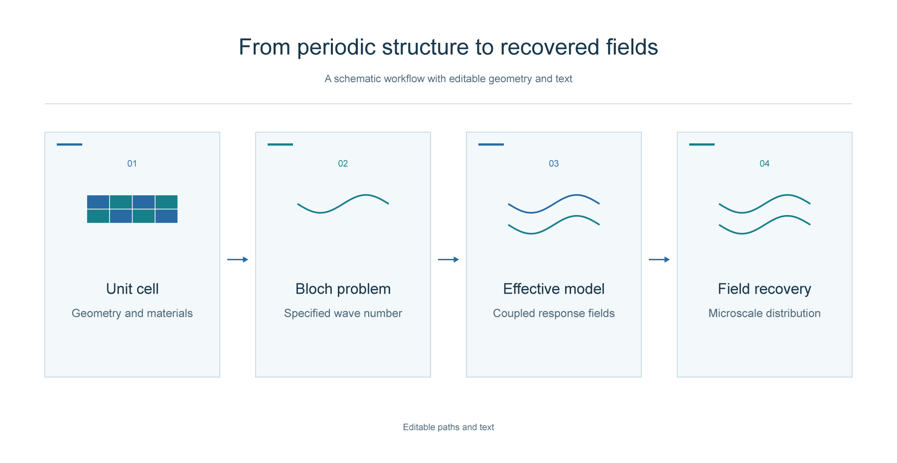

# Scientific Illustrator Workbench

**Ganzhenpeng 的可编辑科研插图 Skill。** 把科研图意、原生矢量绘制与真实 Adobe Illustrator MCP 操作连起来。



适合论文流程图、机制示意、技术结构图，以及已有 AI 文件的局部修改和派生格式导出。它由 Agent 工作流和少量可测试的辅助脚本组成；绘图后端是独立的 [IE3 Illustrator MCP Server](https://github.com/ie3jp/illustrator-mcp-server)。本项目不提供图像生成模型，也不包含 Adobe 软件或授权。

## 融合的能力

- **科研表达**：保留科学关系、符号、原始数据和物理配色；区分示意图与数值结果，按最终显示尺寸审阅。
- **真实对象操作**：通过 IE3 的 MCP 创建、读取和修改 Illustrator 原生路径与文字；主稿保持 AI，预览和投稿格式分别检查。
- **可执行检查**：从真实对象回读文字与边界，检查画板外对象、文字超框、文字碰撞和意外栅格内容。
- **文件保护**：CLI 创建独立输出目录；既有 AI 的检查和导出使用副本，并核对源文件哈希。每次写操作前检查活动文档路径；执行失败不自动重试。
- **复杂图后备**：独立编写的 `native-layout.jsx` 与 Windows runner 支持可信 JSX，自定义机制图无需局限于流程框。

命令行脚手架仅自动布局 **1–6 个横向节点和相邻向前连接**。复杂物理结构、公式资产和分支拓扑由 Agent 使用 MCP 或经审阅的 JSX 处理；本项目不声称能自动理解或验证所有科学内容。

## 环境与安装

当前实测环境：Windows、Adobe Illustrator 2025 **29.4.0**、Node.js **24.19.0**。MCP 固定为 **1.10.3**，后端支持范围与本项目实测范围分别记录。后备 runner 需要 Windows PowerShell；准备运行时需要系统 `tar`。未验证 macOS 端到端使用。

把仓库复制到你的 Skill 目录，例如 `~/.codex/skills/scientific-illustrator-workbench`，或用支持 GitHub 仓库路径的 Skill 安装器安装仓库根目录。`SKILL.md` 是入口，`agents/openai.yaml` 保持自动发现。宿主是否已重新发现该 Skill，应以新会话实际加载为准。

准备固定后端（显式联网、完整性验证、安全解包，不运行 npm 安装钩子）：

```bash
node scripts/prepare-runtime.mjs
node scripts/illustrator.mjs doctor
```

下载地址和 SHA-512 固定在 `runtime-lock.json`，不会自动升级。准备后再次运行 CLI 会检查后端入口、JSX helper 和包元数据的哈希。`.runtime/` 是本地依赖缓存，不提交到仓库。离线环境可传入已取得的相同发布包：

```bash
node scripts/prepare-runtime.mjs --archive /path/to/illustrator-mcp-server-1.10.3.tgz
```

也可使用已审查的后端入口：`--runtime-entry /path/to/dist/bundle.cjs`。这表示调用者负责该入口的来源核验。

## 使用

在支持 Skill 的 Agent 中：

```text
使用 $scientific-illustrator-workbench 为这段研究方法制作一张可编辑科研图。
先根据内容确定布局，保留科学符号，输出 AI 与预览，并检查真实对象。
```

简单流程图先离线规划，再实际绘制：

```bash
node scripts/illustrator.mjs plan --spec examples/workflow.json
node scripts/illustrator.mjs render --spec examples/workflow.json --output output/workflow-v1
```

`--output` 必须是尚不存在的新目录。示例规格含画布、文字和矢量图标；字体须为 Illustrator 可解析的准确名称。自定义规格见 [examples/workflow.json](examples/workflow.json)。输出包括 `figure.ai`、PNG、PDF、实际命名的 SVG，以及独立的计划、回读检查和导出清单。PNG 默认 150% 导出；这不等于期刊最终尺寸或分辨率已经合格。

保护手工修改过的 AI，仅导出 PDF：

```bash
node scripts/illustrator.mjs export --path /path/to/source.ai --format pdf --output output/pdf-v1
```

只读检查使用新副本，不保存原文件：

```bash
node scripts/illustrator.mjs inspect --path /path/to/source.ai --output output/inspect-v1
```

需要实际验证原生文字保存后仍可编辑时：

```bash
node scripts/illustrator.mjs verify --path /path/to/source.ai --output output/edit-test-v1
```

该命令在新副本中修改一处原生文字、保存、关闭并重开核对，不修改原 AI。它只证明这一条文字编辑链路；不代表所有对象或物理内容均已验收。

复杂图的可信 JSX 后备入口：

```powershell
powershell -NoProfile -ExecutionPolicy Bypass -File scripts/guarded-jsx.ps1 `
  -JsxPath examples/native-demo.jsx -OutputRoot output/native-v1
```

这个 runner 创建新文档，提供 `SCI_DOCUMENT`、`SCI_OUTPUT_ROOT`、`SCI_RESULT`。JSX 须经审阅；它仍能访问 `app` 和文件系统，runner 并非恶意代码沙箱。它不用于打开或导出已有原稿。

## 检查范围

```bash
node --test tests/*.test.mjs
```

离线测试覆盖协议交互、错误传播、活动文档保护、规格校验、对象边界和未登记装饰等行为。本机验收与示例来源见 [VALIDATION.md](VALIDATION.md)。

`manifest.json` 中的 `visualReview: pending` 是有意保留的：导出成功不能代替目视审阅。自动碰撞检查使用包围盒，不是精确路径相交；文字成为轮廓后也不能称为原生可编辑文字。读回成功、保存后重开、视觉审阅及物理验证是不同结论。

会话锁只协调使用本 CLI 的执行者。人工或其他软件仍可能切换 Illustrator 文档，路径检查无法完全消除检查与写入之间的竞争；运行时避免同时手动操作。遇到超时或保留锁，先检查进程和 Illustrator 状态，不要盲目删除锁或重复操作。

## 许可与来源

本项目原创工作流、辅助代码与合成示例采用 MIT 许可，作者为 Ganzhenpeng。IE3 后端是单独的 MIT 项目，版权与许可见 [THIRD_PARTY_NOTICES.md](THIRD_PARTY_NOTICES.md)。

本项目取舍来自对科研制图工作流与 MCP 对象操作能力的比较。未复制或打包未声明开源许可的 `boranC33/illustrator-paper-figure-skill` 代码、文字、模板或样式库。Adobe、Illustrator 和相关标识属于各自权利人；本项目与 Adobe 无从属关系。

公开示例只含合成几何，不包含私人论文、未公开数值、凭据或本地路径。以后公开具体图件仍需符合当次用户授权。
